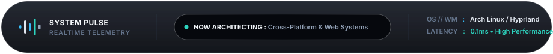

  <!-- APPLE FROSTED GLASS HERO CARD -->
  

    

  <!-- APPLE DYNAMIC ISLAND // SYSTEM PULSE -->
  

    

---

### Engineering Philosophy

I build digital software at the intersection of rigorous systems architecture and fluid product design. Specializing in high-performance cross-platform mobile ecosystems and scalable web infrastructure.

- **Mobile Systems**: Fluid 60fps applications built with Flutter, Dart, and native Android/iOS tooling with clean, decoupled architecture.
- **Web & Core Logic**: High-throughput distributed platforms powered by TypeScript, Next.js, Go, Python, and modern relational storage.
- **Environment**: Driven by the speed, efficiency, and minimalism of Arch Linux, the Hyprland Wayland compositor, and Neovim.

---

### Tech Arsenal

#### Mobile Ecosystem

  

#### Backend & Core Infrastructure

  

#### Modern Web Architecture

  

#### Operating System & Tooling

  

---

### Featured Repositories

<table>
  <tr>
    <td width="50%" valign="top">
      <h3><a href="https://github.com/qcsixx/cyberlens">cyberlens</a></h3>
      
High-precision digital platform and analytical tool engineered with strict TypeScript architecture and reactive components.

      

        
        
      

    </td>
    <td width="50%" valign="top">
      <h3><a href="https://github.com/qcsixx/pawsnature">pawsnature</a></h3>
      
Interactive web application centered on ergonomic user experience, responsive fluidity, and resilient state synchronization.

      

        
        
      

    </td>
  </tr>
  <tr>
    <td width="50%" valign="top">
      <h3><a href="https://github.com/qcsixx/labiot">labiot</a></h3>
      
Modular web ecosystem and backend logic engine built on robust Blade templates and scalable server-side patterns.

      

        
        
      

    </td>
    <td width="50%" valign="top">
      <h3><a href="https://github.com/qcsixx/HRMS">HRMS</a></h3>
      
Enterprise human resource management platform with structured data modeling, secure authentication, and modular workflows.

      

        
        
      

    </td>
  </tr>
</table>

---

### Direct Channels

&nbsp;

&nbsp;

&nbsp;

&nbsp;

  

DESIGNED WITH FROSTED GLASS &amp; TITANIUM METRICS • OPERATING ON ARCH LINUX &amp; HYPRLAND

