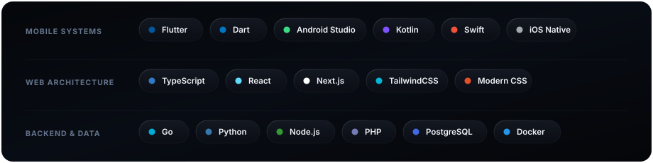
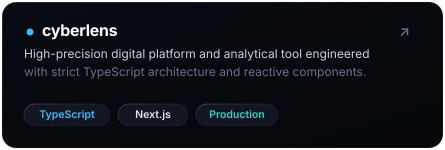
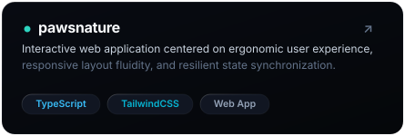

  <!-- 01. APPLE BENTO HERO CARD -->
  

    

  <!-- 02. APPLE DYNAMIC ISLAND // SYSTEM PULSE -->
  

    

  <!-- 03. BENTO TECH ARSENAL MATRIX -->
  

    

  <!-- 04. FEATURED PROJECTS BENTO GRID (SIDE-BY-SIDE) -->
  

    
    &nbsp;
    
  

   

  <!-- 05. APPLE GLASS CONNECT DOCK -->
  

    

  <!-- DIRECT CLICKABLE CHANNELS -->
  

    <a href="https://linkedin.com/in/rifqiprimanda"><b>LinkedIn</b></a>
    &nbsp; • &nbsp;
    <a href="https://instagram.com/prmndaa"><b>Instagram</b></a>
    &nbsp; • &nbsp;
    <a href="https://discord.com/users/qcsixx"><b>Discord</b></a>
    &nbsp; • &nbsp;
    <a href="mailto:rifqiprimanda27@gmail.com"><b>Email</b></a>
    &nbsp; • &nbsp;
    <a href="https://qcsixx.github.io"><b>Portfolio</b></a>
  

