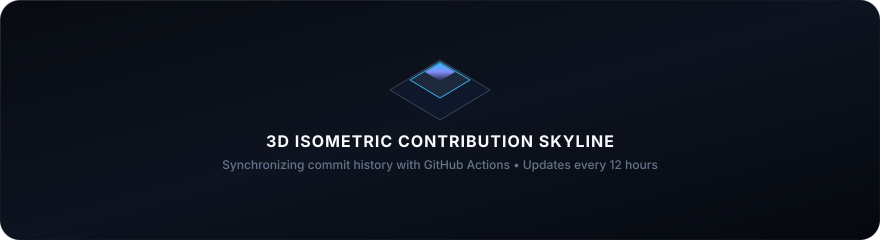

  <!-- 01. GENGAR TITANIUM GLASS BENTO -->
  

    

  <!-- 02. 3D ISOMETRIC CONTRIBUTION SKYLINE -->
  <a href="https://github.com/qcsixx">
    <picture>
      <source media="(prefers-color-scheme: dark)" srcset="./profile-3d-contrib/profile-night-view.svg" />
      <source media="(prefers-color-scheme: light)" srcset="./profile-3d-contrib/profile-night-view.svg" />
      
    </picture>
  </a>

    

  <!-- 03. UNIFIED HIGH-IMPACT TECH STACK (LOGO-ONLY TITANIUM PILLS) -->
  

    
    
    
    
    
    
    
    
    
    
    
    
    
    
    
  

   

  <!-- 04. DIRECT CONNECT / SOCIAL CHANNELS (LOGO-ONLY TITANIUM PILLS) -->
  

    
    &nbsp;
    
    &nbsp;
    
    &nbsp;
    
    &nbsp;
    
  

