  <!-- 01. GENGAR TITANIUM GLASS BENTO -->
  

    

  <!-- 02. WEAPONS OF CHOICE (FLUFFY TECH DOCK) -->
  

    <samp>⚡ <b>weapons of choice</b> &mdash; things I use to turn caffeine into scalable software (and break builds at 3 AM)</samp>
  

  

    
    &nbsp;
    
    &nbsp;
    
    &nbsp;
    
    &nbsp;
    
    &nbsp;
    
    &nbsp;
    
    &nbsp;
    
    &nbsp;
    
    &nbsp;
    
    &nbsp;
    
    &nbsp;
    
  

   

  <!-- 03. DIRECT CONNECT (FLUFFY SOCIAL DOCK) -->
  

    <samp>☕ <b>let's vibe</b> &mdash; got an ambitious idea or wanna roast my commits? slide into my dms</samp>
  

  

    
    &nbsp;&nbsp;
    
    &nbsp;&nbsp;
    
    &nbsp;&nbsp;
    
  

