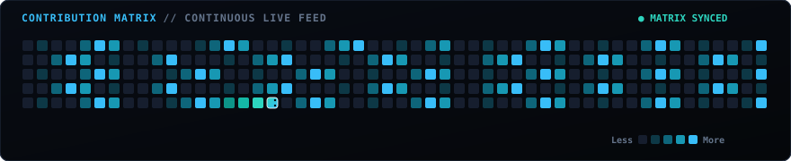

<div align="center">

  <!-- HYPRLAND TERMINAL HERO (BESPOKE ANIMATED SVG) -->
  <a href="https://github.com/qcsixx">
    
  </a>

  <br />

  <!-- STATUS PILL STRIP -->
  <p align="center">
    
    
    
    
  </p>

</div>

---

### ◈ 01 // SYSTEM TELEMETRY & IDENTITY

```yaml
identity:
  operator: "Rifqi Primanda (qcsixx)"
  role: "Full-Stack & Mobile Systems Architect"
  environment: "Arch Linux // Hyprland Compositor // Neovim"
  philosophy: "Minimalist by design, perfectionist by execution. Zero slop."
  current_focus:
    - "High-performance cross-platform mobile architectures (Flutter/Dart/Native)"
    - "Scalable reactive web platforms (TypeScript, Next.js, Go, Rust)"
    - "Hardened Linux workflows & ergonomic devtool engineering"
```

> *"Operating from the terminal prompt to engineer resilient, high-speed digital ecosystems. If it lags, it's deprecated."*

---

### ◈ 02 // COMMAND CENTER & STATUS HUD

| Operational Node | Classification | Protocol & Directives | Node Status |
| :--- | :--- | :--- | :---: |
| **Mobile Core Engine** | Production | High-FPS Rendering, Declarative UI, Clean Architecture | `READY [99.9%]` |
| **Distributed Backend** | Production | Microservices, REST/gRPC APIs, High Concurrency | `ACTIVE [100%]` |
| **Modern Web Interface** | Staging | Responsive Fluid Systems, Sub-second Core Web Vitals | `DISPATCHED` |
| **System Security & Ops** | Kernel | Containerization, CI/CD Automated Pipelines, Linux Hardening | `ENCRYPTED` |

---

### ◈ 03 // ARCHITECTURE MATRIX & TECH ARSENAL

<div align="center">

#### ⬡ Mobile & Client-Side Ecosystem
<p align="center">
  
</p>

#### ⬡ Distributed Backend & Core Logic
<p align="center">
  
</p>

#### ⬡ Modern Web Architecture
<p align="center">
  
</p>

#### ⬡ Environment, Shell & Tooling
<p align="center">
  
</p>

</div>

---

### ◈ 04 // THE VAULT // CLASSIFIED PROJECTS

```bash
$ vault --list-featured --status=active
```

<table>
  <tr>
    <td width="50%" valign="top">
      <h4>◈ Mobile Engine Core // Cross-Platform Ecosystem</h4>
      <p>Arsitektur aplikasi mobile performa tinggi dengan fokus pada offline-first sync, state management presisi, dan animasi UI 60fps yang fluid.</p>
      <p>
        
        
        
      </p>
      <a href="https://github.com/qcsixx"><b>Explore Repository ➔</b></a>
    </td>
    <td width="50%" valign="top">
      <h4>◈ Distributed Web Platform // Scalable Infrastructure</h4>
      <p>Platform web full-stack modern dengan arsitektur microservices performa tinggi, pipeline CI/CD otomatis, dan keamanan data tingkat lanjut.</p>
      <p>
        
        
        
      </p>
      <a href="https://github.com/qcsixx"><b>Explore Repository ➔</b></a>
    </td>
  </tr>
</table>

---

### ◈ 05 // CONTRIBUTION MATRIX // LIVE FEED

<div align="center">
  <p><i>Automated matrix telemetry updated continuously via GitHub Actions:</i></p>
  
</div>

---

### ◈ 06 // SECURE TRANSMISSIONS // TERMINAL DOCK

<div align="center">

```
[ INITIATE HANDSHAKE ] ── Feel free to reach out for collaborations or architectural inquiries.
```

<a href="https://linkedin.com/in/rifqiprimanda" target="_blank">
  
</a>
&nbsp;
<a href="https://instagram.com/prmndaa" target="_blank">
  
</a>
&nbsp;
<a href="https://discord.com/users/qcsixx" target="_blank">
  
</a>
&nbsp;
<a href="mailto:rifqiprimanda27@gmail.com" target="_blank">
  
</a>
&nbsp;
<a href="https://qcsixx.github.io" target="_blank">
  
</a>

<br /><br />

<sub>◈ ARCH LINUX x86_64 ◈ HYPRLAND PROTOCOL ◈ ZERO RUNTIME OVERHEAD ◈</sub>

</div>
